<p align="center">
  
</p>

<h1 align="center">Ange1oc</h1>

<p align="center">
  
</p>

<p align="center">
  <a href="https://photoflash.by"></a>
  <a href="https://github.com/Ange1oc/terminal-setup"></a>
  
</p>

<p align="center">
  <i>“You wanted a banana but what you got was a gorilla holding the banana and the entire jungle.”</i><br/>
  <sub>Joe Armstrong, creator of Erlang</sub>
</p>

## 🐾 Обо мне
С 2020 года занимаюсь бэкендом на Python. Не люблю ограничиваться одной частью проекта - мне интересно самому разобраться в архитектуре, базах данных, инфраструктуре и выжать из всего этого максимум. Делаю собственные продукты, экспериментирую с ML и периодически проверяю, где у PostgreSQL предел.


**Непопулярное мнение:** Вашему проекту, скорее всего, не нужны микросервисы. Начните с [хорошего монолита](https://martinfowler.com/bliki/MonolithFirst.html). Микросервисы не делают систему серьёзнее, Kubernetes не нужен каждому проекту, а JWT - далеко не обязательная часть аутентификации.

```python
class Ange1oc(Cat):
    experience = "6 years 9 months"
    role = "Software Engineer"
    founder = "PhotoFlash.by"

    backend = ["Python", "Starlette", "Django", "Node.js"]
    data = ["PostgreSQL", "Qdrant", "Kafka", "RabbitMQ", "Redis"]

    def solve(self, task: Task) -> Banana:
        return task.banana
```

## 📸 [PhotoFlash.by](https://photoflash.by)

Сервис, где бегун находит свои фото по селфи или номеру на майке. Сделал его сам и сам держу в проде.

Минский полумарафон: **313 000 фотографий за полдня**. Один монолит, ноль горилл.

*Бегаешь по Беларуси? Возможно, свои фото ты уже искал через меня.*

## 🧶 Ещё из интересного

- **Highload:** архитектура медиаплатформы под 150 млн запросов в сутки
- **Data:** потоковая обработка, поиск, рекомендации
- **AI:** нейросети, которые находят тебя в толпе из тысяч бегунов быстрее, чем ты сам
- **Reliability:** ни одно сообщение не потерялось. Сервера старались
- **[termistry](https://github.com/Ange1oc/termistry):** терминал, которым пользуюсь сам. Ставится одной командой

## 🧰 Стек

<p align="center">
  <br/>
  <br/>
  
</p>

## 📈 GitHub

<p align="center">
  
</p>

<p align="center">
  
</p>

<p align="center">
  <sub>🐾 Код ревьюит кот. Все претензии к нему.</sub>
</p>
